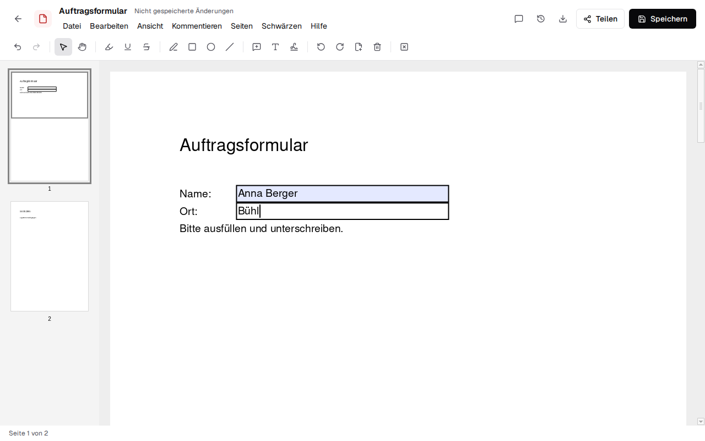
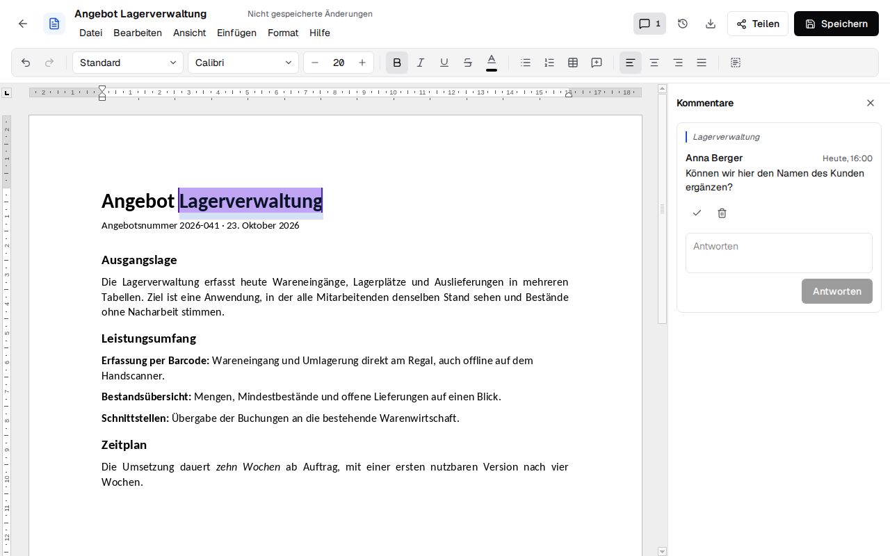
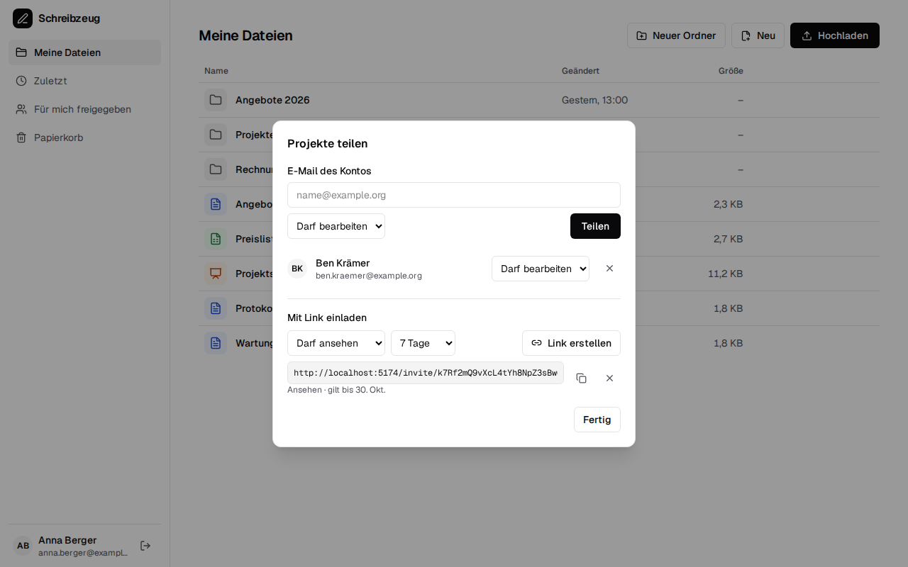

<div align="center">

<h1>Schreibzeug: self-hosted office suite for Word, Excel, PowerPoint and PDF</h1>

**An open-source alternative to Google Docs and Microsoft 365 that runs on your own server.**<br>
Edit documents, spreadsheets, presentations and PDFs together in real time, in the browser or as a desktop app.<br>
Your files stay real .docx, .xlsx and .pptx files, with no document server, no cloud account and no tracking.

[](https://github.com/firsttris/schreibzeug/actions/workflows/ci.yml)
[](https://firsttris.github.io/schreibzeug/)
[](LICENSE)
[](https://firsttris.github.io/schreibzeug/mcp.html)

```bash
docker run -d -p 3000:3000 -v schreibzeug-data:/data tristanteu/schreibzeug
```

[Why](#-why-schreibzeug) •
[Install](#-install) •
[Features](#-features) •
[Screenshots](#-screenshots) •
[Alternatives](#-schreibzeug-and-the-alternatives) •
[FAQ](#-faq) •
[Documentation](https://firsttris.github.io/schreibzeug/)

<picture>
  <source media="(prefers-color-scheme: dark)" srcset="docs/screenshots/editor-dark.png">
  
</picture>

</div>

## 💡 Why Schreibzeug?

Google Docs and Microsoft 365 keep your documents in someone else's cloud and charge per user.
Self-hosted office suites usually need a separate document server next to Nextcloud and look like
the office programs of 2010. Schreibzeug is one small server with a modern interface.

- **Real Office files**: documents are saved as .docx, .xlsx and .pptx (and .odt, .ods, .odp as
  themselves), never converted into a format of its own. Word, Excel and LibreOffice open them as before.
- **Mature compatibility**: the editing engine is Euro-Office (the open-source fork of ONLYOFFICE),
  so tables, tracked changes, comments, charts and pivot tables come through intact.
- **Real-time collaboration without a document server**: several people edit the same file, with
  live cursors and comments; the editor runs in the browser, the server only relays the changes.
- **Your server, your data**: one container with a SQLite database and a data folder; backing up
  that folder backs up everything. No tracking, no telemetry.
- **Browser, desktop and AI assistants**: the same editors in the browser and as a desktop app for
  Windows, macOS and Linux that works offline; Claude Code and other MCP clients work in your
  files with your rights.

Runs on any Linux server or VPS with Docker or Podman (amd64), on a home server, or without any
server as the desktop app on your computer.

## 🚀 Install

```bash
docker run -d --name schreibzeug -p 3000:3000 -v schreibzeug-data:/data tristanteu/schreibzeug
```

Open http://localhost:3000 and create the first account; it becomes the owner of the installation.
More accounts are created through invitation links, or by anyone when `SCHREIBZEUG_OPEN_SIGNUP=true`.
Behind a domain, set `SCHREIBZEUG_URL=https://office.example.org`. The image is published with
each release; until the first one, build it yourself from this repository:

```bash
git clone https://github.com/firsttris/schreibzeug && cd schreibzeug
docker build -f docker/Dockerfile -t tristanteu/schreibzeug .
```

Settings, reverse proxy, backups and updates are in the [installation guide](https://firsttris.github.io/schreibzeug/installation.html).
The desktop app is described under [Desktop app](https://firsttris.github.io/schreibzeug/desktop.html); its installers for Windows, macOS and Linux are attached to every [release](https://github.com/firsttris/schreibzeug/releases).

## ✨ Features

### 📝 Documents (.docx)

- **Writing and layout**: styles, fonts, colours, highlighting, format painter, lists, tables,
  images, links, text boxes, line spacing, page layout, page and section breaks.
- **Long documents**: headers and footers with page numbers, table of contents, footnotes.
- **Reviewing**: comments with replies, tracked changes, spell checking in German and English
  (in the browser, no server needed), find and replace.
- **Letters and invoices**: templates (letter, offer, invoice and your own), **mail merge** from a
  spreadsheet of recipients, and **e-invoices** (ZUGFeRD / Factur-X, EN 16931) from an invoice document.
- **PDF**: export as PDF or PDF/A for archiving, and printing.

### 📊 Spreadsheets (.xlsx) and 📽️ presentations (.pptx)

- **Spreadsheets**: formulas, number formats, sheets, sorting, filters, frozen rows, merged cells,
  charts, **pivot tables**, dropdown lists, conditional formats, CSV files.
- **Presentations**: slide layouts, shapes, designs, transitions, speaker notes and a full-screen
  slide show.

### 📄 PDFs

- **Fill in and sign**: PDF forms, notes, highlighting, drawing, signing by hand or **digitally**
  with your own certificate.
- **Edit pages**: black out, turn, add and remove pages, append another PDF, save pages apart.
- **Scans and e-invoices**: text recognition (OCR) makes scans searchable; the e-invoice inside a
  ZUGFeRD PDF is shown and its XML can be downloaded.

### 📁 Files and teamwork

- **File browser**: folders, drag-and-drop upload, recent files, templates, rename, move and trash.
- **Versions**: every save is kept; any version can be restored.
- **Sharing**: with other accounts or by link with an expiry date, to edit or to view.
- **Real-time co-editing**: everyone editing a file sees the others' changes and cursors, PDFs included.
- **Other formats**: OpenDocument files are edited as they are; .doc, .xls, .ppt and .rtf open as
  an Office copy.

### 🤖 AI assistants and integrations

- **MCP server**: Claude Code and other MCP clients find, read, create and manage files with your
  rights, through a personal access token; they edit an open document after you allow it,
  visibly and undoably. [How to connect](https://firsttris.github.io/schreibzeug/mcp.html)
- **Kontext**: sign in with [Kontext](https://github.com/firsttris/kontext) (OpenID Connect) and use
  Schreibzeug as its "Dokumente" module: mail attachments go into a folder, documents onto a mail.

### 🖥️ Desktop app

- **Windows, macOS and Linux** (Tauri): the files in your documents folder without any server, or a
  window onto a Schreibzeug server. Builds are not signed yet.

## 📸 Screenshots

<table>
  <tr>
    <td></td>
    <td></td>
  </tr>
  <tr>
    <td></td>
    <td></td>
  </tr>
  <tr>
    <td></td>
    <td></td>
  </tr>
</table>

## 🔀 Schreibzeug and the alternatives

Schreibzeug is made for people who want the compatibility of a mature office engine with an
interface that feels like today's web apps, on their own server.

| | What it is | Where Schreibzeug differs |
|---|---|---|
| [ONLYOFFICE Docs](https://github.com/ONLYOFFICE/DocumentServer) / [Euro-Office](https://github.com/Euro-Office) | Collaborative office engine with a Microsoft-Office-like interface, usually embedded in Nextcloud | Same engine, a new interface, its own file management, no document server |
| [Collabora Online](https://github.com/CollaboraOnline/online) | LibreOffice in the browser, strongest with OpenDocument | Focus on Microsoft formats and a modern interface |
| [CryptPad](https://github.com/cryptpad/cryptpad) | End-to-end encrypted collaboration suite | Files stay plain .docx, .xlsx and .pptx on your storage |
| Google Docs, Microsoft 365 | Cloud office suites | Self-hosted, open source, no per-user price, your files unconverted |

## ❓ FAQ

### Is there a self-hosted alternative to Google Docs and Microsoft 365?
Yes. Schreibzeug runs on your own server with Docker and edits Word, Excel, PowerPoint and PDF
files in the browser, several people at once. See the [installation guide](https://firsttris.github.io/schreibzeug/installation.html).

### Does it need an ONLYOFFICE Document Server or Nextcloud?
No. The Euro-Office engine runs in the browser and the Schreibzeug server stores the files and
relays the changes; there is nothing else to install. How that works is in [the engine](https://firsttris.github.io/schreibzeug/engine.html).

### Are my files converted into another format?
No. A .docx stays a .docx, an .xlsx stays an .xlsx, an .odt stays an .odt; every save is a new
version of the same file.

### Can I use Schreibzeug offline, without a server?
Yes, with the desktop app for Windows, macOS and Linux: it opens the files in your documents folder
directly. See [Desktop app](https://firsttris.github.io/schreibzeug/desktop.html).

### Can Claude or other AI assistants edit my documents?
Yes, through the built-in MCP server and a personal access token you create in the settings. Read
access can be limited to "read only"; edits to an open document need your consent and can be
undone. See [MCP server](https://firsttris.github.io/schreibzeug/mcp.html).

### Can I create ZUGFeRD or XRechnung e-invoices?
Yes. An invoice written in the text editor becomes a ZUGFeRD PDF/A-3 with Factur-X XML (EN 16931),
and e-invoices in PDFs are read and shown. See [E-invoices](https://firsttris.github.io/schreibzeug/e-invoice.html).

## 📚 Documentation

The full documentation is at **[firsttris.github.io/schreibzeug](https://firsttris.github.io/schreibzeug/)**.

| | |
|---|---|
| [Installation](https://firsttris.github.io/schreibzeug/installation.html) | Docker, settings, reverse proxy, backups, updates |
| [Accounts and sharing](https://firsttris.github.io/schreibzeug/accounts.html) | sign-up, roles, sharing with accounts and by link |
| [Files and versions](https://firsttris.github.io/schreibzeug/files.html) | folders, versions, trash, the files API |
| [Collaboration](https://firsttris.github.io/schreibzeug/collaboration.html) | real-time co-editing without a document server |
| [PDFs](https://firsttris.github.io/schreibzeug/pdf.html) and [e-invoices](https://firsttris.github.io/schreibzeug/e-invoice.html) | forms, signatures, OCR, ZUGFeRD |
| [MCP server](https://firsttris.github.io/schreibzeug/mcp.html) | Claude Code and other AI assistants |
| [Kontext](https://firsttris.github.io/schreibzeug/kontext.html) | sign-in through Kontext, the "Dokumente" module |
| [Desktop app](https://firsttris.github.io/schreibzeug/desktop.html) | the app for Windows, macOS and Linux |
| [Development](https://firsttris.github.io/schreibzeug/development.html) | building, checks, architecture and the engine |

## 🛠️ Development

Requires [Bun](https://bun.sh) 1.4 or newer, on Linux x86_64 for preparing the engine; the database is a SQLite file.

```bash
git clone https://github.com/firsttris/schreibzeug && cd schreibzeug
bun install
bun run dev              # http://localhost:5173, with the API on http://localhost:3000
```

A React SPA with TanStack Router and Query, Tailwind and shadcn-style components; Euro-Office
`sdkjs` as the editing engine; a Bun server with Hono, Drizzle and SQLite; Tauri 2 for the desktop
app. Checks, tests and architecture: [Development](https://firsttris.github.io/schreibzeug/development.html).

## 🤝 Contributing

Issues and pull requests are welcome. For a rendering or compatibility bug, please attach a file
that shows it (or a small one that reproduces it) and say which program made it. Please run
`bun run lint && bun run typecheck && bun run test` before opening a pull request.

---

<div align="center">

⭐ Like Schreibzeug? A [star on GitHub](https://github.com/firsttris/schreibzeug) helps others find it.<br>
🐛 [Report a bug](https://github.com/firsttris/schreibzeug/issues/new) · 💡 [Request a feature](https://github.com/firsttris/schreibzeug/issues/new)

<sub>License: <a href="LICENSE">AGPL-3.0</a> · © Tristan Teufel and contributors<br>
Changed versions you pass on or run for others must offer their source code under the AGPL; a commercial license without these obligations is available via <a href="https://teufel-it.de">teufel-it.de</a>.<br>
Schreibzeug builds on the open-source Euro-Office engine and is not affiliated with Euro-Office, ONLYOFFICE, Microsoft or Google.</sub>

</div>
