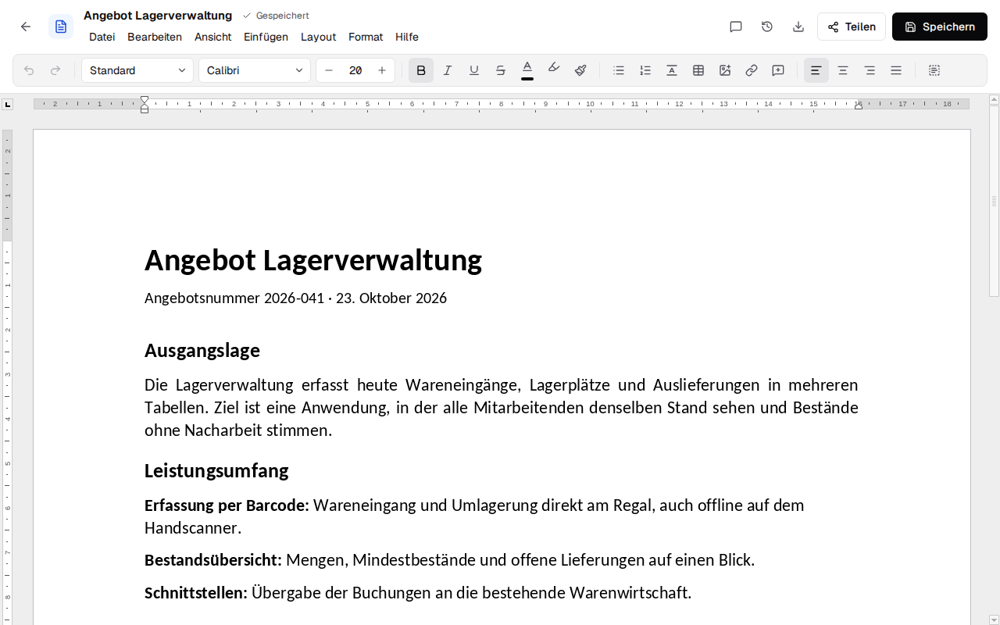
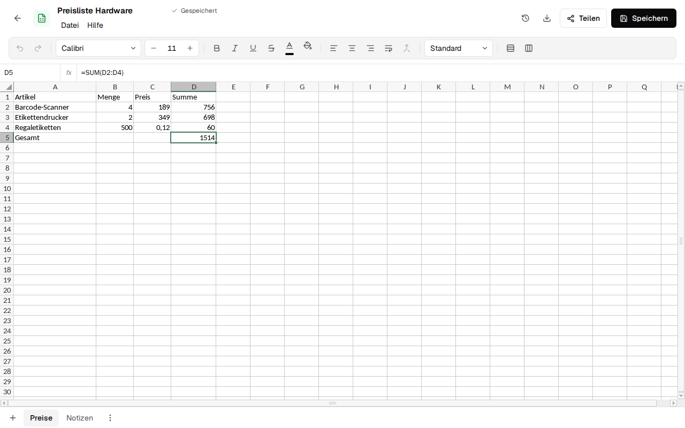
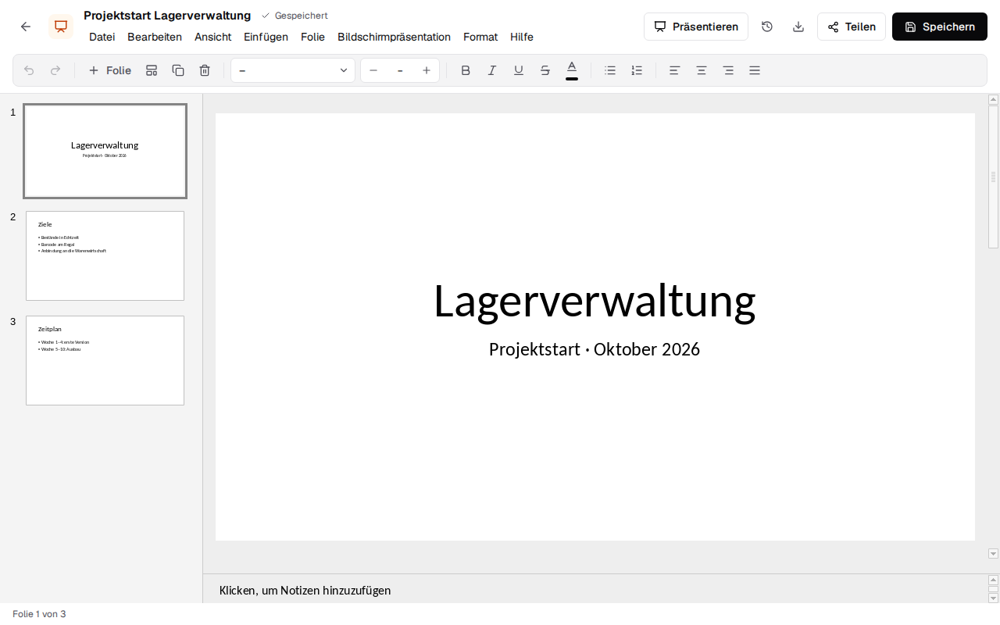
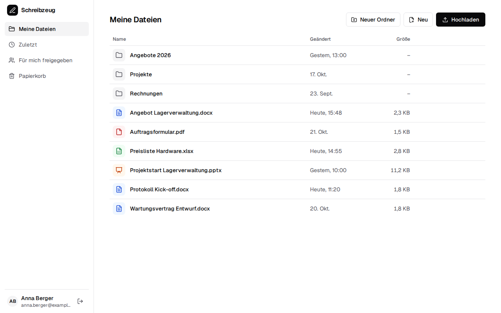

<div align="center">

<h1>Stapel: self-hosted office suite for Word, Excel and PowerPoint files</h1>

**A self-hosted, open-source alternative to Google Docs and Microsoft 365 for .docx, .xlsx and .pptx.**<br>
Edit documents, spreadsheets and presentations together in real time, in the browser or as a desktop app.<br>
A modern interface on the Euro-Office engine: your files stay real Office files, on your own server.

[](LICENSE)


</div>

> **Status:** early development. Nothing to install yet. Working so far: accounts with email and
> password, a file browser (folders,
> upload, new document, spreadsheet or presentation, rename, move, versions, trash), sharing with other accounts or by link (edit or view), a Word editor with a menu bar, context menu, find and replace, PDF export and printing, styles, fonts, colours, highlighting, format painter, lists, tables, images, links, headers and footers with page numbers, page layout, line spacing and
> comments, a spreadsheet editor with formulas, formatting, number formats, sheets, images, comments, menus, find and replace and PDF, and a presentation editor with slides, comments, a full-screen slide show,
> layouts, text formatting, lists, images, menus and PDF. All three save on their own, every save a new version, and several people can edit the
> same file at once. All without a document server. A desktop app for Windows, macOS and Linux
> opens a Stapel server in a window of its own (builds not signed yet).

<picture>
  <source media="(prefers-color-scheme: dark)" srcset="docs/screenshots/editor-dark.png">
  
</picture>

<picture>
  <source media="(prefers-color-scheme: dark)" srcset="docs/screenshots/spreadsheet-dark.png">
  
</picture>

<picture>
  <source media="(prefers-color-scheme: dark)" srcset="docs/screenshots/presentation-dark.png">
  
</picture>

<picture>
  <source media="(prefers-color-scheme: dark)" srcset="docs/screenshots/files-dark.png">
  
</picture>

## 💡 Why Stapel?

Self-hosted office suites today come in two kinds: engines with excellent Microsoft Office
compatibility and a dated interface, or modern interfaces with an engine that falls apart on real
Word and PowerPoint files. Stapel puts a new, clean interface on top of a proven engine.

- **Real Office files**: documents are saved as .docx, .xlsx and .pptx, never converted into a
  format of its own.
- **Real-time collaboration**: several people edit the same file, with live cursors, comments and
  suggestions.
- **Your server, your data**: one Docker image, no cloud account, no tracking.
- **Browser and desktop**: the same editors as a web app and as a desktop app for Linux, Windows and
  macOS, which can replace an installed office suite and works offline.

## ✨ Planned features

### 📁 Files

- **File browser**: folders, upload by drag and drop, recent files, starred, trash.
- **Sharing**: share with other accounts or by a link with an expiry date, to edit or to view
  (done); a comment role.
- **Versions**: every save is kept, any version can be restored.

### 📝 Editors

- **Documents (.docx)**: styles, tables, images, comments, tracked changes.
- **Spreadsheets (.xlsx)**: formulas, number formats, sheets, filters, charts.
- **Presentations (.pptx)**: slide layouts, shapes, themes, speaker notes, presenting.

### 🖥️ Desktop app

- **Default app** for Office files: opens them with a double click, in tabs.
- **Local and server files** side by side; local files work offline.

## 🔀 Stapel and the alternatives

Stapel is made for people who want the compatibility of a mature office engine with an interface
that feels like today's web apps.

| | What it is | Where Stapel differs |
|---|---|---|
| [Euro-Office](https://github.com/Euro-Office) / [ONLYOFFICE Docs](https://github.com/ONLYOFFICE/DocumentServer) | Collaborative office engine with a Microsoft-Office-like interface, usually embedded in Nextcloud | Same engine, new interface, own file management, no document server |
| [Collabora Online](https://github.com/CollaboraOnline/online) | LibreOffice in the browser, strongest with OpenDocument | Focus on Microsoft formats and a modern interface |
| [CryptPad](https://github.com/cryptpad/cryptpad) | End-to-end encrypted collaboration suite | Files stay plain .docx/.xlsx/.pptx on your storage |
| Google Docs, Microsoft 365 | Cloud office suites | Self-hosted, open source, no conversion of your files |

## 🛠️ Development

Requires [Bun](https://bun.sh) 1.4 or newer; nothing else, the database is a SQLite file.

```bash
git clone https://github.com/firsttris/stapel && cd stapel
bun install
bun run dev              # http://localhost:5173, with the files API on http://localhost:3000
```

`bun run dev` first prepares the engine (`bun run engine:prepare`: downloads the pinned Euro-Office
release and generates its fonts, Linux x86_64; a no-op once it is up to date), then starts the
server (data: `STAPEL_DATA_DIR`) and the app together. `bun run server` starts the server alone.

The desktop app is in `apps/desktop` ([how it is built](https://firsttris.github.io/stapel/desktop/));
**Actions → Desktop app** builds it for Windows, macOS and Linux, unsigned for now.

Checks: `bun run lint`, `bun run typecheck`, `bun run test` (unit and integration, on Bun), `bun run test:e2e` (Playwright with the real engine).

Stack: a React SPA with TanStack Router and Query, Tailwind and shadcn-style components; Euro-Office
`sdkjs` as the editing engine; a Bun server with Hono, Drizzle and SQLite for files and the
collaboration relay; Tauri 2 for the desktop app.

## 🤝 Contributing

Issues and pull requests are welcome. For a rendering or compatibility bug, please attach a file
that shows it (or a small one that reproduces it) and say which app it was made with.

---

<div align="center">

⭐ Like Stapel? A [star on GitHub](https://github.com/firsttris/stapel) helps others find it.<br>
🐛 [Report a bug](https://github.com/firsttris/stapel/issues/new) · 💡 [Request a feature](https://github.com/firsttris/stapel/issues/new)

<sub>License: <a href="LICENSE">AGPL-3.0-only</a> · © Tristan Teufel and contributors<br>
Changed versions you pass on or run for others must offer their source code under the AGPL.<br>
Stapel builds on the open-source Euro-Office engine and is not affiliated with Euro-Office, ONLYOFFICE,
Microsoft or Google.</sub>

</div>
