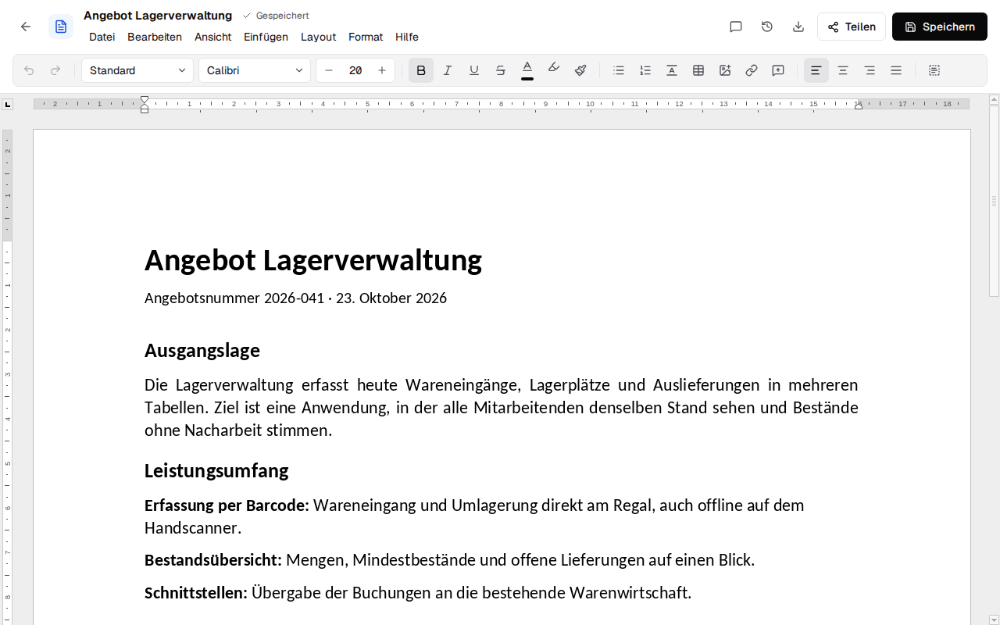

# Schreibzeug { #schreibzeug }

Schreibzeug ist eine selbst gehostete Open-Source-Office-Suite: Dokumente, Tabellen, Präsentationen
und PDFs, gemeinsam in Echtzeit bearbeitet, im Browser oder in einer Desktop-App für Windows, macOS
und Linux. Es nutzt die Euro-Office-Engine (den Open-Source-Fork von ONLYOFFICE) ohne Document
Server, und es lässt deine Dateien, was sie sind: .docx, .xlsx, .pptx, .odt, .ods, .odp und .pdf,
dazu Markdown-Notizen und Textdateien (.md, .txt).

Einen Rundgang in Bildern für Kunden und Kollegen bietet die [Startseite](index.md); die
[Demo](https://firsttris.github.io/schreibzeug/demo/) führt die Editoren mit Beispieldateien im
Browser aus, ohne Server ([wie](development.md#the-demo)).

## Hier anfangen { #start-here }

| | |
|---|---|
| [Installation](installation.md) | den Server mit Docker betreiben: Einstellungen, Reverse Proxy, Backups, Updates, Fehlersuche |
| [Konten und Teilen](accounts.md) | Registrierung, Rollen, Teilen mit Konten und per Link |
| [Anmeldung über Kontext](kontext.md) | OpenID Connect, Schreibzeug als „Dokumente“ in Kontext |
| [Desktop-App](desktop.md) | Dateien auf deinem Rechner ohne Server, oder ein Fenster zu einem Server |

## Benutzen { #using-it }

| | |
|---|---|
| [Dateien und Versionen](files.md) | Ordner, Hochladen, Versionen, Papierkorb, Suche (API und MCP) und die Dateien-API |
| [Zusammenarbeit](collaboration.md) | mehrere Personen in einer Datei, über das Relay des Servers |
| [PDFs](pdf.md) | Formulare, Notizen, Signaturen, OCR, Seiten, PDF/A |
| [Markdown- und Textdateien](text.md) | Notizen mit Live-Vorschau, in ihrer eigenen Kodierung und mit ihren Zeilenenden erhalten |
| [E-Rechnungen](e-invoice.md) | ZUGFeRD und Factur-X: sie lesen und aus einer Rechnung erstellen |
| [MCP-Server](mcp.md) | Claude Code und andere KI-Assistenten in deinen Dateien |
| [Barrierefreiheit](accessibility.md) | WCAG 2.2 AA als Ziel, die Menüleiste per Tastatur, die Screenreader-Unterstützung der Engine (Strg+Alt+Z) |

## Wie es gebaut ist { #how-it-is-built }

| | |
|---|---|
| [Architektur](architecture.md) | die Workspaces, die Web-App, Screenshots und Formattreue |
| [Die Bearbeitungs-Engine](engine.md) | wie die Oberfläche `sdkjs` steuert, Funktion für Funktion |
| [Entwicklung](development.md) | aus dem Quellcode starten, Prüfungen, Tests, Releases |
