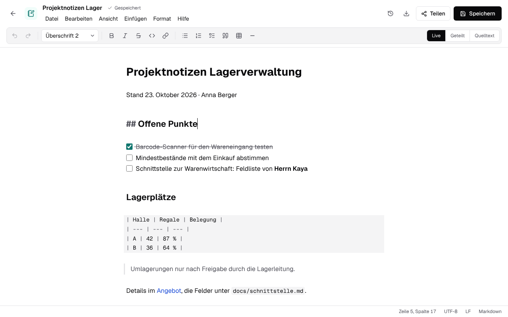

# Markdown- und Textdateien { #markdown-and-text-files }

Schreibzeug öffnet Markdown-Notizen (`.md`) und reine Textdateien (`.txt`) in einem eigenen Editor,
legt sie über „Neu“ an und speichert sie als das, was sie sind: dieselbe Kodierung, dieselben
Zeilenenden, kein eigenes Format. Eine Datei, die niemand bearbeitet hat, wird nie geschrieben.

## Markdown schreiben { #writing-markdown }

Der Editor ist [CodeMirror 6](https://codemirror.net) (MIT), in `packages/text-editor`. Er behält
den Text als Markdown und zeigt ihn nur formatiert an; es gibt kein Rich-Text-Modell, das das
Markdown bei jedem Speichern neu schreiben würde (Listen, Leerzeilen und Tabellen bleiben, wie sie
getippt wurden). Drei Ansichten, pro Browser gemerkt:

| Ansicht | Was sie zeigt |
|---|---|
| Live | Überschriften, fett, kursiv, Code, Links, Zitate, Aufzählungspunkte und Aufgabenkästchen formatiert; die Zeichen (`#`, `**`, die Adresse des Links …) erscheinen in den Zeilen, in denen der Cursor steht. Tabellen und Codeblöcke bleiben Quelltext, in Festbreitenschrift. |
| Geteilt | Links der Quelltext, rechts eine Vorschau, gerendert vom selben Parser (`@lezer/markdown` mit den Tabellen, Aufgabenlisten und dem Durchstreichen von GitHub). |
| Quelltext | Der Quelltext allein, in Festbreitenschrift. |

Die Werkzeugleiste und das Menü „Format“ schreiben Markdown in den Text, so wie es Tippen täte:
eine Überschriftenebene für die Zeile, `**` um die Auswahl (innerhalb von Fettem wieder entfernt),
`- `, `1. ` oder `- [ ] ` vor die ausgewählten Zeilen, einen Link, eine Tabelle mit Kopfzeile, eine
Trennlinie. Ein Häkchen im Kästchen einer Aufgabe in der Live-Ansicht schreibt `[x]`. Strg+B und
Strg+I funktionieren wie in den anderen Editoren; Enter setzt eine Liste oder ein Zitat fort. Die
Befehle sind reine Funktionen über dem Zustand von CodeMirror (`src/commands.ts`), ohne Browser
getestet.

Die Vorschau maskiert jeden Text: Rohes HTML im Markdown erscheint als Text, und Links und Bilder
führen nur zu `http(s)`, `mailto` oder einer relativen Adresse (`src/preview.ts`).

Eine `.txt`-Datei öffnet sich im selben Editor in Festbreitenschrift, ohne Werkzeugleiste, Vorschau
oder Markdown.

## Die Datei lassen, wie sie ist { #keeping-the-file-as-it-is }

`src/codec.ts` liest die Bytes und schreibt sie zurück:

- **Kodierung**: Eine Byte-Order-Mark entscheidet (UTF-8, UTF-16 LE/BE); ohne eine UTF-8, wenn die
  Bytes gültiges UTF-8 sind, sonst Windows-1252, das ältere deutsche Textdateien aus Windows
  verwenden. Ein Zeichen, für das die Kodierung der Datei kein Byte hat (ein Emoji in einer
  Windows-1252-Datei), wird nicht verworfen: Das Speichern scheitert mit einer Meldung, die es
  nennt.
- **Byte-Order-Mark**: bleibt erhalten, wenn es eine gab; eine neue Datei hat keine.
- **Zeilenenden**: Der Editor arbeitet mit `\n`; das Speichern schreibt das Ende, das die meisten
  Zeilen hatten (LF, CRLF oder CR), auch für Zeilen, die mit einem anderen eingefügt wurden. Eine
  neue Datei nutzt LF.

Die Statusleiste zeigt den Cursor, die Kodierung, das Zeilenende und die Art der Datei. Ein
unveränderter Text mit einer einzigen Art Zeilenende ergibt beim Kodieren dieselben Bytes, aus
denen er gelesen wurde (`test/codec.test.ts`); in einer Datei, deren Zeilen unterschiedlich enden,
gibt ein Speichern allen das häufigste Ende. Deshalb wird eine unveränderte Datei nie geschrieben:
Speichern ohne Änderung speichert nichts, und `write_text` hängt an die Bytes an, wie sie sind.

## Speichern { #saving }

Eine Textdatei hat keine Bearbeitungssitzung und kein Relay: Der Editor speichert die ganze Datei,
von Hand oder zwei Sekunden nach der letzten Änderung (15 Sekunden nach einem gescheiterten
Speichern). Jedes Speichern geschieht **über der Version, aus der es entstand**: Es schickt
`If-Match: "<sha256>"`, den SHA-256 der Bytes, die es geöffnet oder zuletzt gespeichert hat, und
der Server speichert es nur, solange das noch die neueste Version ist
(`apps/server/src/files/repository.ts` `addVersion`, in derselben Transaktion geprüft; auf dem
Desktop die Bytes auf der Festplatte, sodass auch ein Schreiben durch ein anderes Programm zählt).
Sonst antwortet er 409 mit `CHANGED_SINCE`, und der Editor hört auf, von selbst zu speichern, und
fragt:

- **Neue Fassung laden** verwirft diesen Text und öffnet die neueste Version;
- **Als Kopie speichern** behält diesen Text als „… (Kopie).md“ daneben und öffnet diese.

Zwei Fenster auf einer Notiz überschreiben sich deshalb nie unbemerkt. Echtzeit-Bearbeitung von
Textdateien zu mehreren, mit den Cursorn der anderen, bräuchte ein eigenes Relay (Yjs über eine
WebSocket-Route); das gehört noch nicht dazu.

Versionen, Wiederherstellen, Teilen, Links, Kopien und Umbenennen funktionieren wie für jede andere
Datei ([Dateien](files.md)).

## Claude und andere MCP-Clients { #claude-and-other-mcp-clients }

`read_document` liest `.md` und `.txt`, `upload_file` mit `text` legt eine Notiz an, und
`write_text` ersetzt den Text einer Notiz oder Textdatei oder hängt an ihn an, in der eigenen
Kodierung und mit den Zeilenenden der Datei, über der Version, die es gelesen hat
([MCP-Server](mcp.md#tools)).

## Tests { #tests }

- `packages/text-editor/test`: Kodierung, Byte-Order-Mark und Zeilenenden im Hin und Zurück; die
  Befehle der Werkzeugleiste; die Vorschau und ihr Maskieren; der Zustand „geändert“ und die
  Ansichten des Editors (happy-dom).
- `apps/server/test/files.test.ts`, `apps/local/test/files.test.ts`: leere Notizen und
  Textdateien, Speichern über einer Version, ein abgelehntes Speichern, das die Datei lässt, wie sie
  war, zwei Speichervorgänge über derselben Version.
- `apps/server/test/mcp-create.test.ts`: `write_text` in einer Windows-1252-Datei mit CRLF.
- `e2e/text.spec.ts`: eine Notiz, über „Neu“ angelegt, über die Werkzeugleiste formatiert und von
  selbst gespeichert; die geteilte Ansicht; eine Windows-Datei Byte für Byte erhalten; zwei Fenster
  auf einer Notiz.
