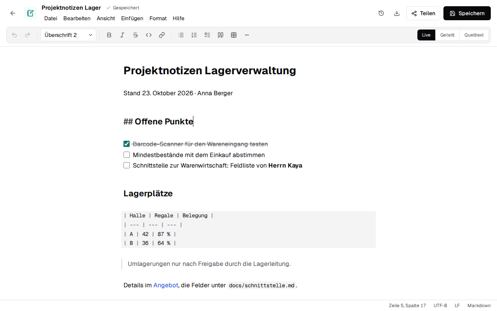

# Markdown and text files

Schreibzeug opens Markdown notes (`.md`) and plain text files (`.txt`) in an editor of their own,
creates them from "Neu", and saves them as what they are: the same encoding, the same line
endings, no own format. A file nobody edited is never written.

## Writing Markdown

The editor is [CodeMirror 6](https://codemirror.net) (MIT), in `packages/text-editor`. It keeps
the text as Markdown and only shows it formatted; there is no rich-text model that would write the
Markdown anew on every save (lists, blank lines and tables stay as they were typed). Three views,
remembered per browser:

| View | What it shows |
|---|---|
| Live | Headings, bold, italic, code, links, quotes, bullets and task boxes formatted; the marks (`#`, `**`, the link's address …) appear in the lines the cursor is in. Tables and code blocks stay as source, in monospace. |
| Geteilt | The source on the left, a preview on the right, rendered from the same parser (`@lezer/markdown` with GitHub's tables, task lists and strikethrough). |
| Quelltext | The source alone, in monospace. |

The toolbar and the "Format" menu write Markdown into the text, as typing it would: a heading
level for the line, `**` around the selection (taken away again inside bold), `- `, `1. ` or
`- [ ] ` before the selected lines, a link, a table with a header row, a rule. Ticking a task's box
in the live view writes `[x]`. Strg+B and Strg+I work as in the other editors; Enter continues a
list or a quote. The commands are pure functions over CodeMirror's state
(`src/commands.ts`), tested without a browser.

The preview escapes every text: raw HTML in the Markdown shows as text, and links and images only
go to `http(s)`, `mailto` or a relative address (`src/preview.ts`).

A `.txt` file opens in the same editor in monospace, without toolbar, preview or Markdown.

## Keeping the file as it is

`src/codec.ts` reads the bytes and writes them back:

- **Encoding**: a byte order mark decides (UTF-8, UTF-16 LE/BE); without one, UTF-8 when the bytes
  are valid UTF-8, else Windows-1252, which older German text files from Windows use. A character
  the file's encoding has no byte for (an emoji in a Windows-1252 file) is not dropped: the save
  fails with a message naming it.
- **Byte order mark**: kept when there was one; a new file has none.
- **Line endings**: the editor works with `\n`; the save writes the ending most lines had (LF, CRLF
  or CR), also for lines pasted with another one. A new file uses LF.

The status bar shows the cursor, the encoding, the line ending and the kind of file. An unchanged
text with one kind of line ending encodes to the same bytes it was read from
(`test/codec.test.ts`); in a file whose lines end in different ways, a save gives them all the
most common ending. That is why an unchanged file is never written: saving without a change stores
nothing, and `write_text` appends to the bytes as they are.

## Saving

A text file has no editing session and no relay: the editor saves the whole file, by hand or two
seconds after the last change (15 seconds after a failed save). Every save is made **over the
version it was made from**: it sends `If-Match: "<sha256>"`, the SHA-256 of the bytes it opened or
last stored, and the server stores it only while that is still the newest version
(`apps/server/src/files/repository.ts` `addVersion`, checked in the same transaction; on the
desktop the bytes on disk, so a write by another program counts too). Otherwise it answers 409 with
`CHANGED_SINCE`, and the editor stops saving on its own and asks:

- **Neue Fassung laden** throws this text away and opens the newest version;
- **Als Kopie speichern** keeps this text as "… (Kopie).md" beside it and opens that.

Two windows on one note therefore never overwrite each other unnoticed. Real-time co-editing of
text files, with the others' cursors, would need a relay of its own (Yjs over a WebSocket route);
it is not part of this yet.

Versions, restoring, sharing, links, copies and renaming work as for every other file
([files](files.md)).

## Claude and other MCP clients

`read_document` reads `.md` and `.txt`, `upload_file` with `text` creates a note, and `write_text`
replaces or appends to the text of a note or text file in the file's own encoding and line endings,
made over the version it read ([MCP server](mcp.md#tools)).

## Tests

- `packages/text-editor/test`: encoding, byte order mark and line endings round trip; the toolbar's
  commands; the preview and its escaping; the editor's "modified" state and views (happy-dom).
- `apps/server/test/files.test.ts`, `apps/local/test/files.test.ts`: empty notes and text files,
  saves over a version, a refused save leaving the file as it was, two saves over the same version.
- `apps/server/test/mcp-create.test.ts`: `write_text` in a Windows-1252 file with CRLF.
- `e2e/text.spec.ts`: a note created from "Neu", formatted from the toolbar and saved on its own;
  the split view; a Windows file kept byte for byte; two windows on one note.
